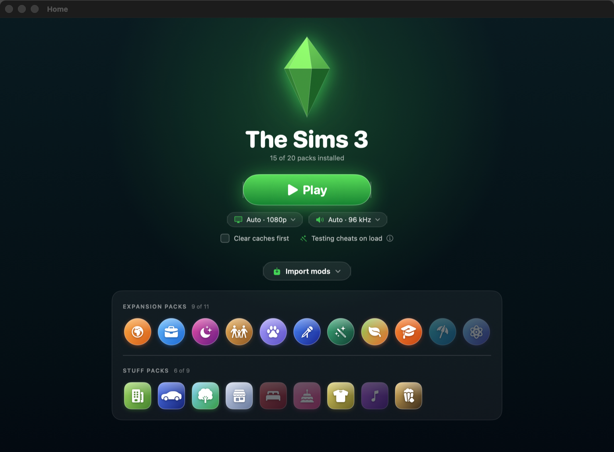
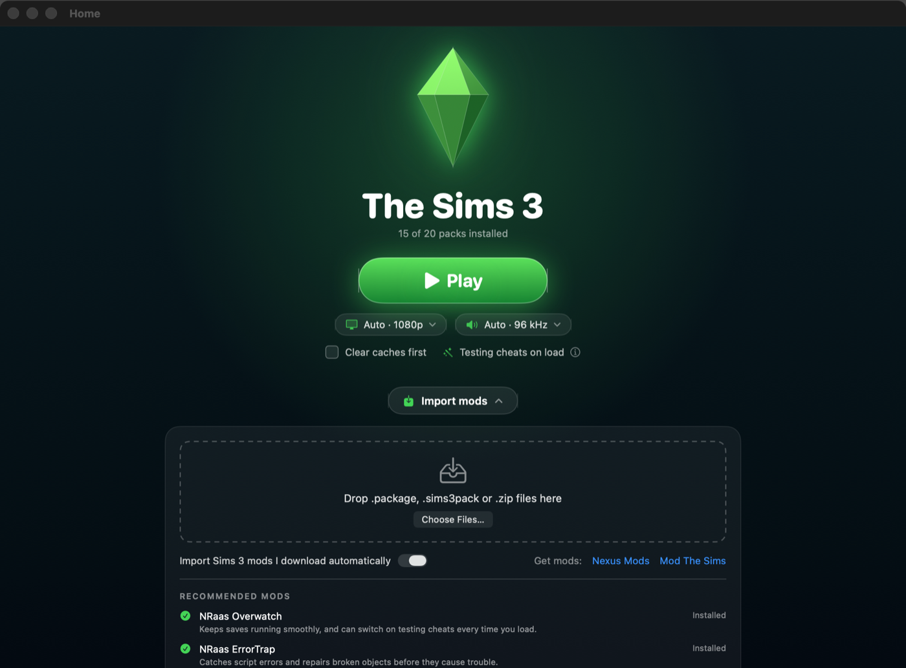
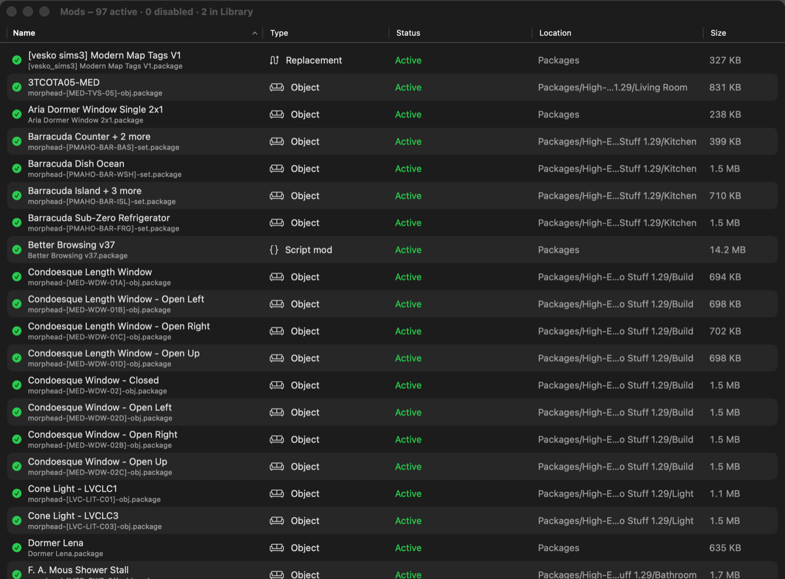
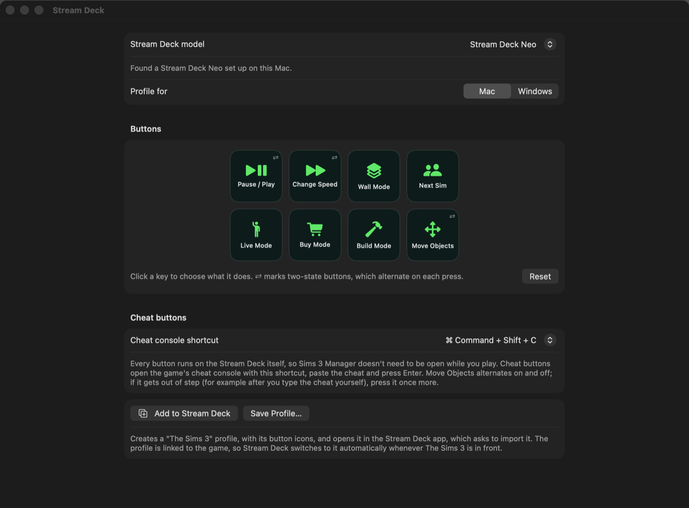

# The Sims 3 Manager for Apple Silicon

> [!IMPORTANT]
> This software was compiled using Claude Code and is provided as-is. It is unlikely to get major updates. Please feel free to fork and improve upon this code.
 
A Mac app that replaces the EA Sims 3 Launcher. It starts the game, manages your mods, imports custom content and builds Stream Deck controls, without the Launcher's crashing Downloads tab.



| Importing mods | Your mods | Stream Deck |
|---|---|---|
|  |  |  |

**Requires:** a Mac with Apple Silicon (M1 or newer), macOS 14 or later, and the 64-bit EA app version of The Sims 3.

## Installing

1. Download the latest zip from [Releases](../../releases), unzip it and drag **Sims 3 Manager** into your Applications folder.
2. Open it. macOS will say it can't verify the developer, because the app isn't signed with an Apple Developer ID.
3. Open **System Settings → Privacy & Security**, scroll down and click **Open Anyway** next to Sims 3 Manager. You only need to do this once.

The first time it reads your Documents and Downloads folders, macOS asks for permission. Allow both.

## What it does

### Home
- **Play** starts the game through the EA app, which still checks your license and signs you in.
- **Display and sound are automatic** unless you change them under **Advanced** in each menu:
  - **Display:** the game runs in a 1080p window, which works on any Mac. Under Advanced you can choose a fullscreen mode; it draws more real pixels, but fullscreen at a resolution other than your screen's own (such as 1440p on a 4K screen) can make mouse clicks land in the wrong place. Your choice is written into the game's `Options.ini` each time you press Play.
  - **Sound:** the Mac version of the game crackles ("popcorn" sound) at some sample rates; 96 kHz is the most widely reported fix. Automatic switches your current output to 96 kHz while the game runs (or the closest rate it supports). Under Advanced you can pick a specific device and rate. The app keeps the setting in place if the output resets (HDMI TVs often drop back to 48 kHz when the game changes the screen mode), and puts your previous device and rate back when you quit.
- **Clear caches first** deletes the game's cache files before starting (they go to the Trash and the game rebuilds them). This helps after adding or removing mods.
- **Testing cheats on load** explains how to switch it on with the NRaas Overwatch mod.
- **Import mods:** drop `.package`, `.sims3pack` or `.zip` files, or folders, or double-click a `.sims3pack` in Finder. Objects and Create-a-Sim items go to `Mods/Packages`, lots and households to `Library`, and worlds to `InstalledWorlds`. While the app is open, Sims 3 mods you download are imported automatically (Sims 4 mods are ignored). EA Store content is encrypted and can't be installed on a Mac by any tool, so it's refused with an explanation.
- **Recommended mods** lists a few widely used mods with links to their official pages, and shows which you already have. Mods aren't bundled, so you always get the authors' current versions.
- Shows which expansion and stuff packs you have installed.

### Mods
- One list of everything in `Mods/Packages`, `Mods/Overrides`, `Mods/Disabled` and your `Library`, showing each item's in-game name (where the file has one) and its type: script mod, object, build item, Create-a-Sim, tuning tweak, replacement, household or lot.
- Flags mods the game won't load (leftover `.sims3pack` files, folders nested too deep).
- **Disable** moves a mod to `Mods/Disabled`, which the game ignores, and **Enable** puts it back. Deleting always goes to the Trash.

### Stream Deck
- Pick your Stream Deck model, choose an action for each key and click **Add to Stream Deck**. The app creates a "The Sims 3" profile (with its button icons) for the Stream Deck app to import. It is linked to the game, so Stream Deck switches to it whenever The Sims 3 is in front.
- Every button runs on the Stream Deck itself, so Sims 3 Manager doesn't need to be open while you play, and no extra permissions are needed.
- Plain buttons send game shortcuts: pause, speeds, wall modes, floors, next Sim, Live/Buy/Build mode and more.
- Two-state buttons (marked ⇄) alternate on each press: **Pause/Play** (P, then 1), **Change Speed** (fast, then ultra fast) and **Move Objects** (on, then off).
- Cheat buttons open the game's cheat console (⌘⇧C, or ⌃⇧C if you choose), paste the cheat and press Enter.
- **For Windows players:** see [Stream Deck Profile for Windows](#stream-deck-profile-for-windows) at the bottom of this page.

### Tools
- Clear caches, set up the Mods folder, open the game folders, and locate the game.
- **Skip the Launcher window:** makes the EA app open the game directly instead of the old EA Launcher. This edits one line in `Sims3Launcher.app/Contents/__Installer/installerdata.xml`, saving the original to `~/Library/Application Support/Sims3Manager/`. It only happens when you click the button, and **Restore EA's Original Setting** undoes it. An EA app Repair or update can switch it back; the Home screen tells you if that happens.

## Building from source

You need the Xcode Command Line Tools (`xcode-select --install`); full Xcode isn't required.

```bash
./build.sh      # builds, signs for local use and installs to ~/Applications
./package.sh    # also makes dist/Sims 3 Manager <version>.zip (Apple Silicon only)
```

The app has command-line test modes used during development, for example `--scan`, `--mod-names`, `--check FILE`, `--import-to DIR FILE…`, `--list-audio` and `--screenshots DIR` (which redraws the README screenshots). See `Sources/Sims3Manager/main.swift`.

## Good to know

- Importing lots and households has had little testing so far. Check that they appear in the game's Edit Town bin.
- If your Sims 3 folder lives on an external drive, connect it before opening the app.
- This is a beta (1.0-beta-3). Please report problems on the [Issues](../../issues) page.

## Licence and trademarks

Sims 3 Manager is free software under the [GNU General Public License v3.0](LICENSE).

It isn't made by, endorsed by or affiliated with Electronic Arts. The Sims is a trademark of Electronic Arts Inc. No EA artwork or game files are included: the pack badges and app icon are original, and the app only reads your own installed copy of the game.

## Stream Deck Profile for Windows

Sims 3 Manager is a Mac app, but Windows players can use its Stream Deck profile too. It has the same buttons (pause/play, speed, wall modes, next Sim, Live/Buy/Build mode and the Move Objects cheat) with Windows keys, and opens the cheat console with Ctrl+Shift+C.

1. Download **Sims.3.Stream.Deck.profiles.Windows.zip** from the [latest release](../../releases).
2. Unzip it and double-click the profile for your Stream Deck model (Neo, Mini, 15-key, + or XL).
3. Stream Deck asks to import it. Switch to the "The Sims 3" profile while you play.

On a Mac you can also make one yourself: in the Stream Deck page choose **Profile for: Windows**, then **Save Profile…**

These profiles are **experimental**: they haven't been tested on a Windows Stream Deck yet. Please report how they work in [Issues](../../issues).
